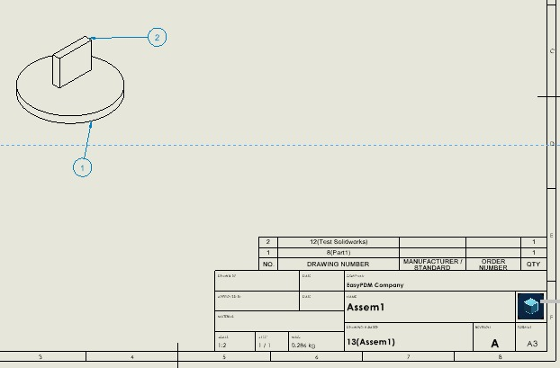

# Changelog

All notable changes to EasyPDM for SolidWorks are documented in this file. Until 0.9 the macros
and the drawing sheet were released with EasyPDM itself; see the
[EasyPDM changelog](https://github.com/pawelcel/EasyPDM/blob/main/CHANGELOG.md) for that history.

## [Unreleased]

## [0.9.2]

**In short:** the target folder of Download and Upload no longer nests a new subfolder on every run.

Update: close SOLIDWORKS, unpack the new zip over the old folder and run `install.cmd` as administrator again.

### Fixed
- **Nested target folders.** A target folder typed as a bare name (e.g. `test`) was taken relative to the current SolidWorks folder, which is the folder last downloaded into, so every Download or Upload added another level (`D:\Documents\test\test\test…`). Both macros now ask for a full path (`D:\…` or `\\server\…`) and no longer offer a relative one remembered by an older version. ([#1](https://github.com/pawelcel/EasyPDM-SolidWorks-Addon/issues/1))

## [0.9.1]

**In short:** assembly drawings get a parts list, and their balloons follow it. Upload draws the assembly's direct components as a table above the processes table, numbered by their position in the structure in EasyPDM, and sets the drawing's balloons to the same numbers. Needs [EasyPDM 0.9.4](https://github.com/pawelcel/EasyPDM/releases/tag/v0.9.4) or later.

Update: close SOLIDWORKS, unpack the new zip and both new `.swp` macros over the old folder and run `install.cmd` as administrator again.

### Added
- **Parts list on assembly drawings.** On the first sheet of an assembly's drawing, Upload builds a parts list above the processes table, as EasyPDM for FreeCAD 0.9.9 does: number, drawing number (with the name's translations under it), manufacturer / standard, order numbers and quantity of each direct component, numbered by its position in the assembly's structure in EasyPDM, 156 mm wide against the frame's right edge, continued in a column to the left when it would reach the revisions table or the top of the frame. Needs EasyPDM 0.9.4 or later.
- **Balloons numbered from the parts list.** Every balloon on the drawing gets the number of the component it is attached to (through the component's EasyPDM item), so the balloons, the list and the structure in EasyPDM agree; a balloon on something not on the list keeps its text. The number becomes the balloon's own text (as "Balloon text: Text" in its properties), so the balloon keeps its place, leader, style and size.

## [0.9.0]

**In short:** the first release of EasyPDM for SolidWorks on its own, and the first with an add-in. An EasyPDM tab in the CommandManager with Upload, Download, Lock and Log in/out; a document panel in the Task Pane with the item's record, revision, status and lock, and for an assembly the tree of its components marked current or outdated; an Upload that refuses work built on outdated files; signing in through the browser, so SOLIDWORKS never sees your password; English, Polish and German, following SOLIDWORKS' language.

**Install** (Windows, SOLIDWORKS 2024 SP5 tested; needs an [EasyPDM 0.9](https://github.com/pawelcel/EasyPDM/releases) server):

1. Download `EasyPDM_SolidWorks_Addin_v0.9.0.zip` and the two compiled macros `EasyPDMUpload.swp` and `EasyPDMDownload.swp` below.
2. Unpack the zip into a folder that stays (for example `C:\EasyPDM\SolidWorks`) and put both `.swp` files into the same folder.
3. Close SOLIDWORKS, right-click `install.cmd` → **Run as administrator**.
4. Start SOLIDWORKS: the **EasyPDM** tab appears for parts, assemblies and drawings (other Windows users tick EasyPDM under Tools → Add-Ins). **Log in/out** signs you in through the browser.

Updating from a test build: close SOLIDWORKS, replace the files in the same folder and run `install.cmd` again. `uninstall.cmd` (as administrator) removes the add-in.

The EasyPDM drawing sheet formats and templates are not attached; take them from [`templates/` at this release](https://github.com/pawelcel/EasyPDM-SolidWorks-Addon/tree/v0.9.0/templates). Until now the SolidWorks macros and sheets were released with EasyPDM itself, up to [EasyPDM 0.9.0](https://github.com/pawelcel/EasyPDM/blob/main/CHANGELOG.md).

### Added
- **The EasyPDM add-in**: an EasyPDM tab in the CommandManager for parts, assemblies and drawings, and a Tools → EasyPDM menu. Upload, Download and Log in/out run the EasyPDM macros, compiled next to the add-in, so they behave exactly like the macros; the add-in finds the macro's module by itself, whatever it was named when the macro was compiled.
- **Document panel** in the Task Pane: who is signed in and where, the active document's item (record, name, revision, status, who holds the lock) with Refresh, Open in browser, Lock / Release, Upload and Log in / Log out, and for an assembly the tree of its components marked ✓ newest, • changed here, – not in EasyPDM yet or ⚠ newer file in EasyPDM, with who uploaded it and when. It follows the active document and asks the server in the background.
- **Lock** and **Log in/out**, one button each: Lock is pressed while you hold the lock and greyed out for a released item or someone else's lock; Log in/out is pressed while you are signed in.
- **Upload refuses work built on outdated files**: when the document or one of its components has a newer file in EasyPDM (a new revision, or the same revision uploaded again), Upload lists them with who uploaded the newer file and when, instead of sending. Needs an EasyPDM 0.9 server.
- **Version stamp on every upload.** The Upload macro writes a new `EasyPDM_ContentVersion` custom property into the part or assembly before sending it, so EasyPDM recognises the file also after SOLIDWORKS saves it again unchanged. For files the macro copies into EasyPDM's shared storage the server keeps the stamp from the next EasyPDM release; until then those files are recognised by their content and revision.
- **Signing in through the browser everywhere**: when the login is missing or expired, Upload and Download (from the add-in or as macros) open the browser sign-in instead of asking for a login and password. The password login remains only for EasyPDM servers before 0.9.
- English, Polish and German, in SOLIDWORKS' own language (English when "Use English language menus" is ticked); the macros follow it too instead of the Windows display language.
- The add-in writes what it asked the server and decided to `%TEMP%\EasyPDM_addin.log`, beside the macros' logs.
- **A repository of its own**, moved out of EasyPDM (`EasyPDM.SolidWorks/`) with its history.

### Fixed
- **Signing in through the browser left the macros logged out** (the macros of EasyPDM 0.9.0). They talked to the server through WinINet, whose cookie jar, shared with Internet Explorer, kept the cookie of an earlier password login and sent it beside the new token; the server took the old, revoked one. They now use WinHTTP (`MSXML2.ServerXMLHTTP.6.0`), which has no shared jar and no cache.
- **Log in on a server before 0.9** said the login failed; it now says the server is too old for the browser sign-in.
